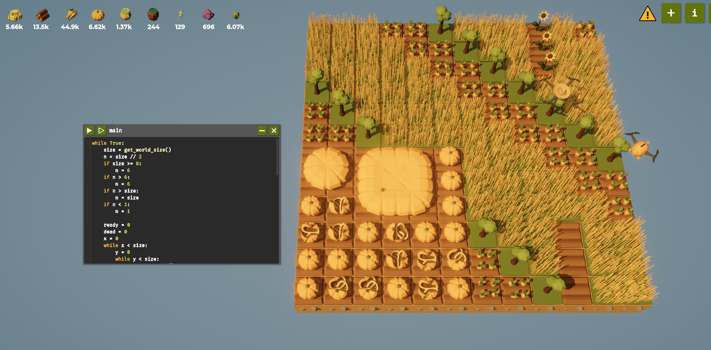
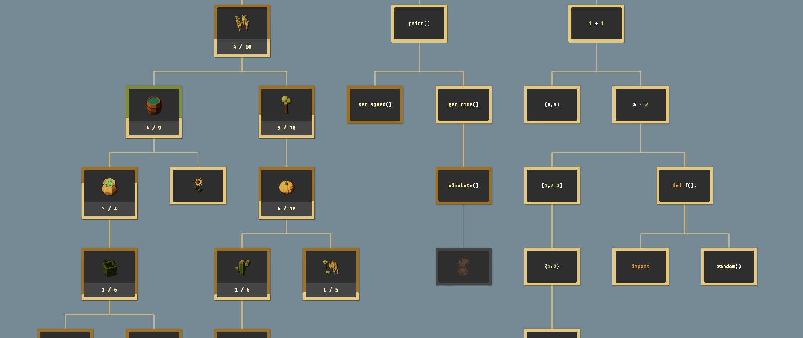

Фотографии: 

Код: 
while True:
	size = get_world_size()
	n = size // 2
	if size >= 8:
		n = 6
	if n > 6:
		n = 6
	if n > size:
		n = size
	if n < 1:
		n = 1

	ready = 0
	dead = 0
	x = 0
	while x < size:
		y = 0
		while y < size:
			px = get_pos_x()
			py = get_pos_y()

			if px < n and py < n:
				if get_ground_type() != Grounds.Soil:
					till()

				entity = get_entity_type()

				if entity == Entities.Dead_Pumpkin:
					dead = dead + 1
					plant(Entities.Pumpkin)
				elif entity == Entities.Pumpkin:
					if can_harvest():
						ready = ready + 1
				else:
					if can_harvest():
						harvest()
					plant(Entities.Pumpkin)
			else:
				if can_harvest():
					harvest()
				spot = px + py
				if spot % 8 == 0:
					if get_ground_type() != Grounds.Grassland:
						till()
					plant(Entities.Tree)
				elif spot % 8 <= 5:
					if get_ground_type() != Grounds.Grassland:
						till()
				else:
					if get_ground_type() != Grounds.Soil:
						till()
					plant(Entities.Carrot)

			if get_water() < 0.5:
				use_item(Items.Water)

			move(North)
			y = y + 1
		move(East)
		x = x + 1

	if dead == 0:
		if ready >= n * n:
			while get_pos_x() != 0:
				move(West)
			while get_pos_y() != 0:
				move(South)
			if can_harvest():
				harvest()